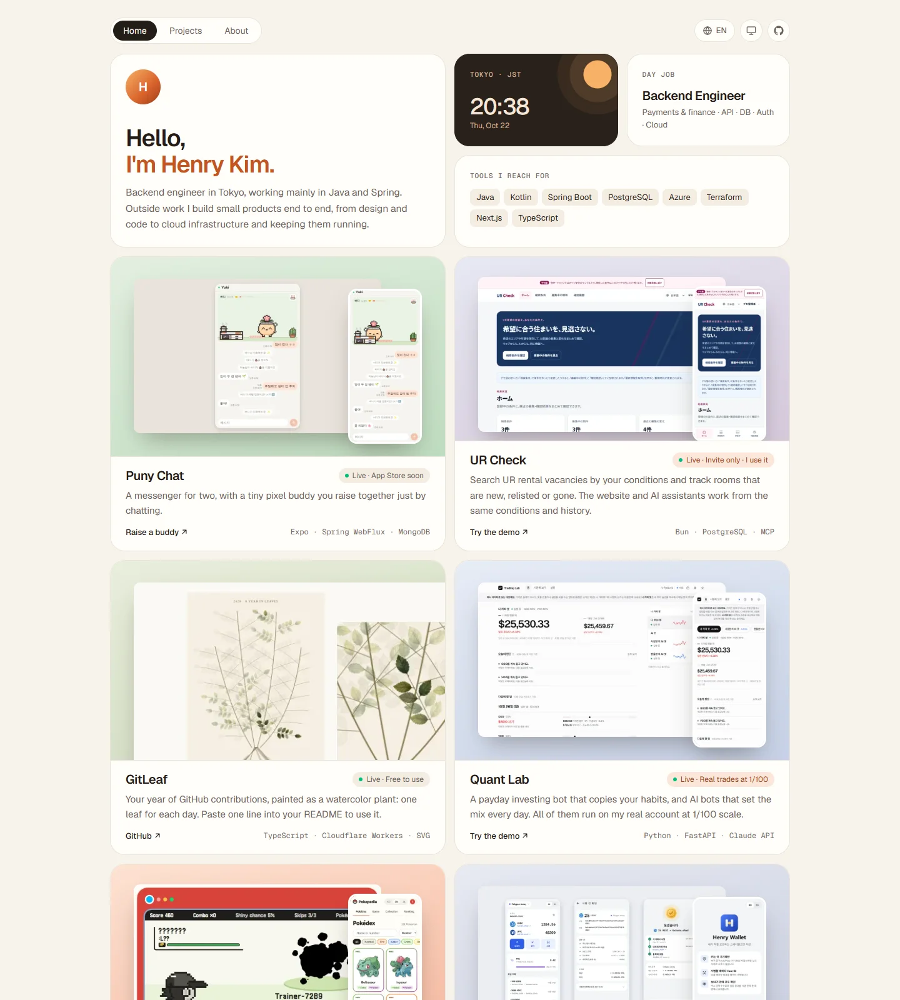

# Portfolio Hub

Henry Kim의 사이드 프로젝트를 모아 둔 포트폴리오 사이트입니다. 영어·일본어·한국어로 볼 수 있습니다.

**https://www.portfolio-hub.dev**

<picture>
  <source media="(prefers-color-scheme: dark)" srcset="docs/readme/portfolio-dark.webp">
  
</picture>

## 기술 구성

| 영역 | 사용 기술 |
| --- | --- |
| 프레임워크 | Nuxt 4 · Vue 3 (`<script setup>`) · TypeScript |
| 스타일 | Tailwind CSS 4 · Geist Sans/Mono |
| 이미지 | Nuxt Image (빌드 시 최적화) |
| 빌드 | `nuxt generate`로 전 페이지 정적 생성 |
| 배포 | Cloudflare Pages · GitHub Actions |

서버 런타임과 DB 없이 정적 HTML만 배포합니다. 언어는 영어(`/`), 일본어(`/ja`), 한국어(`/ko`) 경로로 나뉩니다.

## 폴더 구조

```
app/
  content/projects/   프로젝트별 글(index.ts 영어, ja.ts, ko.ts)
  i18n/               UI 문구 번역
  components/         화면 컴포넌트
  pages/              라우트
  lib/                타입, 프로젝트 정렬·검증, 다이어그램 배치
public/images/        이미지 원본
scripts/              자산 생성, 정적 결과 검사, HTTP 검사
docs/                 결정사항, 구조 설명, 배포, 검증 기준 파일
```

## 실행

Node 24, pnpm 10을 사용합니다.

```sh
pnpm install
pnpm dev          # http://127.0.0.1:3000
```

## 검사와 빌드

```sh
pnpm check        # lint, 타입 검사
pnpm generate     # 정적 생성 후 기준 결과와 비교
pnpm test:pages   # 생성된 사이트를 로컬에서 띄워 HTTP 검사
pnpm preview      # 생성 결과 미리보기: http://127.0.0.1:4173
pnpm diagrams     # 프로젝트 구성도를 docs/architecture에 SVG·PNG로 내보내기
```

CI는 PR마다 같은 검사를 돌리고, main에 병합하면 Cloudflare Pages에 배포됩니다.

## 프로젝트 추가·수정

1. `app/content/projects/<slug>/`에 `index.ts`(영어)와 `ja.ts`, `ko.ts`를 둡니다.
2. 이미지는 `public/images/content/projects/<slug>/`에 넣습니다.
3. 글은 [AGENTS.md](AGENTS.md)의 글쓰기 원칙을 따릅니다.
4. `pnpm generate`가 기준 결과(`docs/baseline.json`)와 다르다고 하면, 바뀐 내용이 의도한 것인지 확인한 뒤 기준을 갱신합니다.

## 문서

- [결정사항](docs/DECISIONS.md)
- [구조 설명](docs/ARCHITECTURE.md)
- [배포와 도메인](docs/DEPLOYMENT.md)
- [작업 지침](AGENTS.md)
