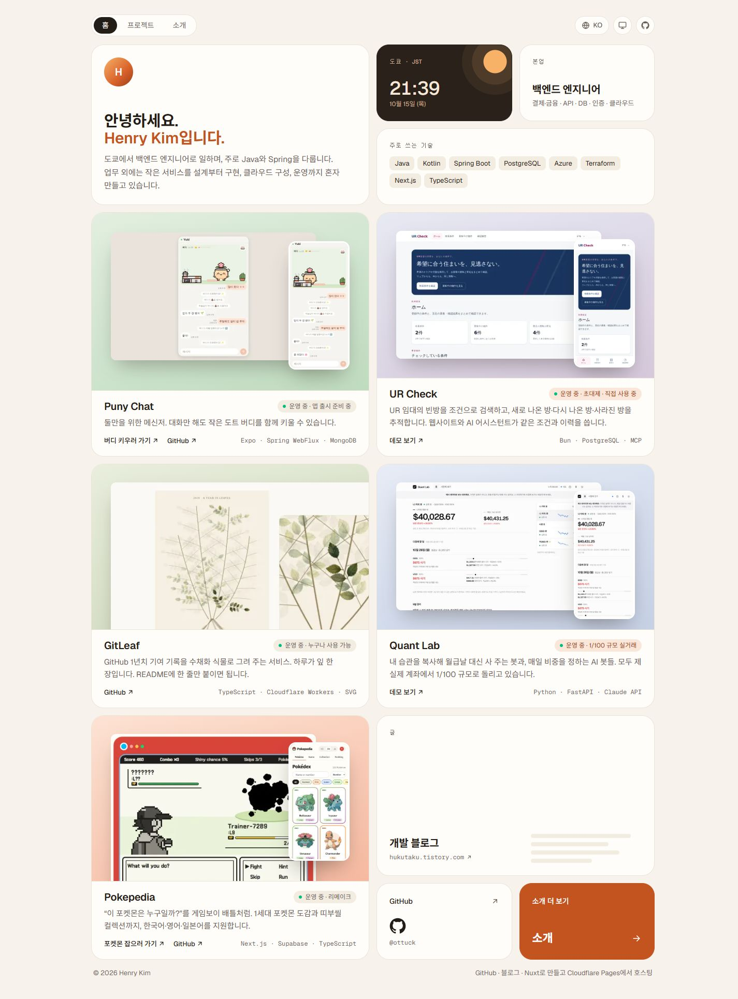

# Portfolio Hub

Henry Kim의 사이드 프로젝트를 소개하는 포트폴리오입니다. 기존 Next.js 사이트의 디자인·콘텐츠·기능·URL을 유지하면서 Nuxt 4와 Vue 3로 이전했습니다.



## 확정 사항

- 대상 GitHub 저장소: `ottuck/portfolio-hub-nuxt`, **비공개**
- Nuxt 4 · Vue 3 Composition API · TypeScript · Tailwind CSS 4 · pnpm
- `nuxt generate`로 정적 생성하고 Cloudflare Pages에 `.output/public` 배포
- 기존 UI, 3개 언어, 프로젝트 상세 페이지, SEO와 리다이렉트 유지
- 기존 Next.js 저장소와 Vercel Production은 전환 검증이 끝날 때까지 유지

## 작업 문서

- [결정사항과 구현 계획](docs/MIGRATION.md)
- [기존 코드 조사와 기준 정보](docs/BASELINE.md)
- [완료 검증 목록](docs/ACCEPTANCE.md)
- [콘텐츠 URL 기준 목록](docs/routes.json)
- [검증 결과](docs/VALIDATION.md)
- [배포 및 도메인 전환](docs/DEPLOYMENT.md)
- [프로젝트 작업 지침](AGENTS.md)

## 현재 상태

2026-10-15 기준 Nuxt 구현과 Cloudflare Pages main 배포, `www.portfolio-hub.dev`의 DNS·HTTPS 전환을 완료했습니다. 기존 디자인과 3개 언어·30개 페이지를 보존했고, 실제 운영 주소에서 경로·이미지·OG·SEO·308·404와 Analytics 단일 주입을 확인했습니다. GitHub는 비공개입니다. 등록 기관·DNS와 루트 도메인의 308 리다이렉트는 Vercel에 유지하며 기존 배포도 복구용으로 보관합니다.

운영 사이트: https://www.portfolio-hub.dev/ko

## 실행과 검사

Node 24.22.0, pnpm 10.33.0을 사용합니다.

```sh
pnpm install --frozen-lockfile
pnpm dev          # http://127.0.0.1:3000
pnpm check        # lint와 앱·빌드 스크립트 타입 검사
pnpm generate     # 자산 생성 → 정적 생성 → 404/헤더 마무리 → 원본 대비 검사
pnpm test:pages   # 로컬 Pages HTTP 검사 후 서버 종료
pnpm preview      # 정적 결과물 미리보기: http://127.0.0.1:4173
```

콘텐츠는 `app/content/`, UI 번역은 `app/i18n/`, 프로젝트 처리 로직은 `app/lib/`, 이미지 원본은 `public/images/`에 있습니다. 원본 비교 자료 `docs/baseline.json`은 마이그레이션 기준입니다. 향후 콘텐츠를 의도적으로 갱신할 때에는 기대값과 변경 이유를 함께 검토하세요.

원본: https://github.com/ottuck/portfolio-hub

비교 사이트: https://www.portfolio-hub.dev/ko
