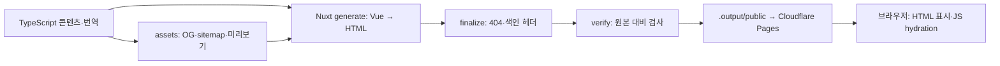

# Next.js에서 Nuxt 4로 옮긴 구조와 읽는 순서

이 문서는 Vue·Nuxt를 처음 사용하는 개발자를 위한 실제 프로젝트 설명이다. 비교 기준은 원본 `ottuck/portfolio-hub`의 `5d2aa96`이다. 운영 주소는 기존 `https://www.portfolio-hub.dev/ko`를 그대로 유지한다. 영어는 `/`, 일본어는 `/ja`, 한국어는 `/ko`다.

## 1. Vue와 Nuxt의 역할

React가 컴포넌트와 상태를 다루는 것처럼 Vue도 화면과 반응형 상태를 다룬다. Next.js가 React 위에서 라우팅·렌더링·빌드를 제공하듯, Nuxt는 Vue 위에서 같은 종류의 역할을 한다. Nuxt의 기본 렌더링 모델이 React Server Components와 동일한 것은 아니다.

| 역할 | 기존 프로젝트 | 현재 프로젝트 |
| --- | --- | --- |
| 화면 컴포넌트 | React, `.tsx`, JSX | Vue 3, `.vue`, template |
| 파일 기반 라우터 | Next App Router | Nuxt `app/pages/` |
| 공통 프레임 | `src/views/root-shell.tsx`, 언어별 layout | `app/app.vue` |
| 메타데이터 | `generateMetadata`, Next `Metadata` | `useHead`, `usePageSeo` |
| 페이지 데이터 | TypeScript 콘텐츠와 유틸리티 | 같은 데이터·로직을 재사용 |
| 이미지 | `next/image` | `NuxtImg`, 빌드 시 정적 변형 생성 |
| OG | Next `opengraph-image.tsx` | Satori·Resvg 빌드 스크립트 |
| 스타일 | Tailwind 4, CSS 토큰 | 같은 Tailwind 4와 CSS 토큰 |
| 배포 | Vercel, Next 빌드 | Cloudflare Pages, `.output/public` |
| 분석 | Vercel Analytics·Speed Insights | Cloudflare Web Analytics |

## 2. 폴더 구조

```text
portfolio-hub-nuxt/
├─ app/
│  ├─ app.vue                  # 헤더·페이지·푸터, 현재 언어
│  ├─ pages/                   # URL과 화면을 연결하는 얇은 파일
│  │  ├─ index.vue             # /
│  │  ├─ about.vue             # /about
│  │  ├─ projects/
│  │  │  ├─ index.vue          # /projects
│  │  │  └─ [slug].vue         # /projects/puny-chat 등
│  │  └─ [locale]/             # 같은 화면의 /ja, /ko 경로
│  ├─ components/              # 화면과 재사용 컴포넌트
│  │  ├─ HomeView.vue
│  │  ├─ ProjectsView.vue
│  │  ├─ ProjectView.vue
│  │  ├─ AboutView.vue
│  │  ├─ ProjectImage.vue
│  │  ├─ ThemeToggle.vue
│  │  └─ TokyoClock.vue
│  ├─ composables/usePageSeo.ts # 재사용 가능한 head·JSON-LD 로직
│  ├─ content/                 # 프로필, 프로젝트별 영문·일문·한글
│  ├─ i18n/                    # UI 번역, 언어·경로 유틸리티
│  ├─ lib/                     # 타입, 프로젝트 검증·조회·정렬·병합
│  ├─ assets/css/main.css      # Tailwind, 색상·폰트·다크모드
│  ├─ generated/               # 스크립트로 만드는 이미지 미리보기
│  └─ error.vue                # 앱에서 발생한 오류 화면
├─ public/                     # URL로 직접 제공하는 이미지·폰트·아이콘
│  ├─ images/                  # 기존 WebP 원본
│  ├─ fonts/                   # 브라우저용 Geist와 라이선스
│  └─ _redirects               # 기존 경로·OG URL의 308 규칙
├─ assets/og-fonts/            # OG 생성용 폰트와 라이선스
├─ scripts/                    # 자산 생성, 정적 출력 마무리, 검증
├─ docs/                       # 결정·비교 기준·배포·검증 기록
├─ nuxt.config.ts              # Nuxt, Image, prerender, head 설정
├─ wrangler.jsonc              # Pages 출력과 환경별 빌드 변수
└─ .github/workflows/ci.yml    # 설치·lint·타입·generate·Pages 검사
```

`.nuxt/`는 Nuxt가 만드는 개발·타입·빌드 작업 폴더다. `.output/public/`은 최종 정적 배포 결과물이다. 둘 다 직접 수정하는 소스가 아니다. `public/og/`, sitemap, robots와 이미지 placeholder도 생성 스크립트를 기준으로 관리한다.

기존 `src/views/`의 화면은 지금 `app/components/*View.vue`에 있다. `pages`에 큰 화면 코드를 넣지 않고, 경로 파라미터를 검사하고 해당 View에 데이터를 넘기는 구조다.

## 3. URL 하나를 따라가 보기

`/ko/projects/puny-chat` 요청을 예로 들면 다음 순서다.

1. `app/pages/[locale]/projects/[slug].vue`가 URL과 매칭된다.
2. `locale=ko`, `slug=puny-chat`를 읽고 지원하는 언어와 slug인지 검사한다.
3. `getProject(slug, locale)`가 영문 원본과 한국어 번역을 합쳐 프로젝트를 만든다.
4. `ProjectView.vue`가 상세 화면을 그리고 SEO·JSON-LD를 등록한다.
5. `app.vue`가 같은 페이지 주위에 공통 헤더와 푸터를 붙인다.

운영에서는 이 작업으로 미리 생성한 HTML 파일을 Pages가 보낸다. 브라우저 내부 이동 시에는 Nuxt 라우터가 화면과 head를 바꾼다.

| 원본 Next 파일 | 현재 Nuxt 파일 | URL |
| --- | --- | --- |
| `src/app/(en)/page.tsx` | `app/pages/index.vue` | `/` |
| `src/app/[locale]/page.tsx` | `app/pages/[locale]/index.vue` | `/ja`, `/ko` |
| `src/app/(en)/projects/[slug]/page.tsx` | `app/pages/projects/[slug].vue` | `/projects/:slug` |
| `src/app/[locale]/projects/[slug]/page.tsx` | `app/pages/[locale]/projects/[slug].vue` | `/:locale/projects/:slug` |

영어용 파일과 언어 접두사 파일을 나눈 것은 기존 URL을 유지하기 위해서다. `[locale]`이 있어도 모든 언어를 허용하지 않는다. `ja`, `ko`만 통과하고 `/fr`이나 없는 프로젝트는 404로 처리한다.

원본의 `generateStaticParams()` 역할은 `docs/routes.json`과 `nuxt.config.ts`의 prerender 설정으로 옮겼다. 이전 당시 홈·목록·About·상세 7개를 3개 언어로 만들어 총 30개였고, 2026-10-22 `henry-wallet`을 더해 33개다. 목록에서 숨긴 `ur-manager`, `ur-mcp`도 상세 URL은 생성한다. `unlisted` 프로젝트는 링크가 없으므로 `pnpm assets`가 쓰는 `app/generated/unlisted-routes.json`으로 prerender 경로에 더한다(현재 없음).

## 4. `.vue` 파일 읽는 법

Vue Single File Component(SFC)는 한 파일 안에서 로직과 화면을 나눈다. 이 프로젝트는 `<script setup lang="ts">`와 `<template>`을 사용하고 스타일은 대부분 Tailwind와 공통 CSS에 둔다.

```vue
<script setup lang="ts">
const theme = ref<'system' | 'light' | 'dark'>('system')

function cycle() {
  theme.value = theme.value === 'system' ? 'light' : 'system'
}
</script>

<template>
  <button @click="cycle">현재 설정: {{ theme }}</button>
</template>
```

위 코드는 문법 설명용 축약 예시다. 실제 테마는 `ThemeToggle.vue`에서 시스템 → 라이트 → 다크 순으로 돌고, HTML 속성과 localStorage도 갱신한다.

- `ref()`는 반응형 값을 만든다. 스크립트에서는 `theme.value`, template에서는 자동으로 풀리므로 `theme`으로 읽는다.
- `computed()`는 다른 반응형 값에서 계산한 값을 만든다. React `useMemo`와 비교해 이해할 수 있지만, Vue는 읽은 반응형 의존성을 추적하므로 dependency 배열을 직접 적지 않는다.
- `defineProps<T>()`는 부모에게 받는 props의 타입을 선언한다. 예: `ProjectView`는 `locale`, `project`를 받는다.
- `{{ project.name }}`은 텍스트 출력, `:href="url"`은 속성 바인딩, `@click="cycle"`은 이벤트 연결이다.
- `v-if`는 조건부 표시, `v-for`는 반복이다. JSX의 조건식·`.map()`과 대응해서 읽으면 된다.
- `NuxtLink`는 Next의 `Link`에 대응한다. 내부 탐색에 사용하고 외부 사이트는 일반 `<a>`를 쓴다. 현재 언어 메뉴는 같은 콘텐츠의 언어 URL로 일반 링크 이동을 한다.

Vue의 `ref`, `computed`, `onMounted`와 Nuxt composable·컴포넌트가 import 없이 보이는 것은 Nuxt의 자동 import 기능 때문이다. 프로젝트의 일반 TypeScript 모듈은 명시적으로 import한다. `~/`는 이 프로젝트에서 `app/` 기준 경로다.

기존 테마와 시계는 React `useSyncExternalStore`를 썼다. 새 구현은 `ref`와 생명주기 hook으로 옮겼다. 시계는 `onMounted()`에서 15초 interval을 시작하고 `onBeforeUnmount()`에서 정리한다.

Vue에 Next의 `"use client"`를 복사하지 않는다. 이 프로젝트의 Vue 컴포넌트는 빌드 시 서버에서 HTML을 만들고 브라우저에서 hydration한다. `window`, `document`, localStorage처럼 브라우저에만 있는 기능은 `onMounted()` 또는 사용자 이벤트 안에서 사용한다. 테마의 첫 페인트는 head 초기화 스크립트가 처리한다.

## 5. 데이터와 디자인은 어떻게 보존했나

`content/`, `i18n/`, 프로젝트 검증·정렬·병합 로직은 가능한 한 그대로 옮겼다. CMS나 DB, 새 전역 상태 라이브러리를 넣지 않았다. 프로젝트 이름·본문·번역·링크·정렬·숨김 관계가 바뀌면 프레임워크 이전과 콘텐츠 변경을 구분하기 어려워지기 때문이다.

Next의 `StaticImageData`와 이미지 import는 프레임워크 독립적인 `src`, `width`, `height` 메타데이터로 바꿨다. WebP 원본 34개는 그대로 보관한다.

Tailwind 클래스, 색상 토큰, `light-dark()`, 카드 간격과 반응형 기준을 재사용했다. Geist 파일은 라이선스와 함께 직접 제공하여 폰트 패키지를 통해 Next·React peer dependency가 다시 들어오지 않게 했다. 푸터의 구현 기술과 호스팅 문구는 새 스택으로 바꾸되, 소개의 개인 기술 목록에 있는 Next.js는 사용자 콘텐츠라 유지했다.

## 6. 렌더링과 빌드가 달라진 부분

기존 Next도 페이지를 상당 부분 정적으로 생성했다. 다만 `output: 'export'`를 사용한 전체 정적 배포는 아니었고, 기본 `next/image` 등 Next·Vercel 제공 기능에 의존했다. 새 프로젝트는 요청 시 서버 없이 서비스할 수 있도록 이미지와 OG까지 빌드 결과물에 포함한다.



`ssr: true`는 서버 렌더링 방식을 유지한다는 뜻이다. 이번 배포에서는 그 렌더링을 `nuxt generate` 중에 수행한다. 따라서 SSR을 켰다는 사실이 운영에 Node 서버가 필요하다는 뜻은 아니다. Nitro는 개발 서버와 빌드·prerender에 사용하고, 운영 출력은 `static` 프리셋으로 고정했다.

`ProjectImage.vue`는 `NuxtImg`를 감싸서 srcset·sizes·이미지 크기·lazy loading·주요 이미지 우선순위를 모은 컴포넌트다. 운영 URL에 `/_ipx/`가 보여도 이 프로젝트에서는 최적화된 정적 파일 경로다. 요청마다 이미지 서버를 실행하지 않는다. 작은 placeholder는 CSS 배경으로 두어 JavaScript가 없어도 최종 이미지가 HTML에 남게 했다.

## 7. SEO와 404

Next의 `generateMetadata()`는 `usePageSeo()`로 옮겼다. 이 composable은 `useHead()`로 title·description·canonical·hreflang·OG·Twitter 값을 등록한다. `useStructuredData()`는 JSON-LD를 출력한다. getter로 넘긴 locale·project 값을 읽기 때문에 클라이언트 경로 변경에도 head가 맞춰진다.

OG PNG 9개, sitemap 33개 항목, robots는 `scripts/generate-assets.ts`에서 생성한다. 운영 메타데이터는 기존 도메인, Preview OG는 해당 Preview 도메인을 사용한다. Pages 기본 도메인과 Preview에는 noindex를 적용하고, 정상 운영 도메인은 색인을 허용한다.

404는 두 경우를 나눠 처리했다. 앱 탐색 중 오류는 `app/error.vue`가, 없는 URL의 직접 HTTP 요청은 빌드 후 생성한 언어별 정적 `404.html`이 처리한다. 임의 경로를 전부 200으로 바꾸는 SPA fallback은 제거했다. 기존 프로젝트명과 Next OG URL은 `public/_redirects`의 308로 호환한다.

## 8. 검증과 배포

원본 Next 빌드에서 `docs/baseline.json`을 추출하고, 새 HTML의 본문·링크·alt·메타데이터·JSON-LD를 비교했다. 화면도 원본과 같은 viewport에서 비교했다. 검증 범위와 미실시 항목은 `VALIDATION.md`, `ACCEPTANCE.md`에 명시한다.

CI는 frozen lockfile 설치 → lint·타입 검사 → generate·정적 검증 → 로컬 Pages HTTP 검사 순서다. 실제 Pages와 운영 도메인에서는 30개 경로, 이미지·OG, redirect·쿼리 보존, 없는 경로의 실제 404를 확인했다. 정적 참조 306개와 폰트·sitemap·robots를 더한 310개도 실제 응답을 확인했다.

작업 브랜치를 push하면 Pages Preview가 만들어지고, CI와 Preview 확인 후 main에 병합한다. main push는 운영 배포로 연결된다. GitHub 저장소가 비공개인 것과 운영 사이트가 공개되는 것은 별개다.

## 9. 앞으로 수정할 때

| 하고 싶은 수정 | 먼저 볼 위치 |
| --- | --- |
| 이름·소개·외부 링크 | `app/content/site.ts`, `app/i18n/dictionaries.ts` |
| 프로젝트 설명·기술·이미지 | `app/content/projects/<slug>/index.ts`, `ja.ts`, `ko.ts` |
| 홈 레이아웃·프로젝트 카드 | `HomeView.vue`, `ProjectTile.vue`, `ProjectShot.vue` |
| 상세 레이아웃 | `ProjectView.vue`, `ProjectFigure.vue` |
| 색상·폰트·다크모드 | `app/assets/css/main.css`, `ThemeToggle.vue` |
| SEO | `app/composables/usePageSeo.ts` |
| OG 구성·sitemap·robots | `scripts/generate-assets.ts` |
| 정적 생성·이미지 크기 기준 | `nuxt.config.ts` |
| Pages 환경변수 | `wrangler.jsonc` |

새 프로젝트를 추가할 때에는 콘텐츠 모듈 등록과 함께 `docs/routes.json`의 세 언어 URL도 갱신한다. 원본 비교 파일은 새 구현에 맞춰 무조건 재생성하지 않는다. 의도적인 콘텐츠 변경의 기대값과 이유를 함께 갱신한다.

Node 24.22.0, pnpm 10.33.0에서 아래 명령을 쓴다.

```sh
pnpm install --frozen-lockfile
pnpm dev          # 개발 서버, 변경사항 즉시 반영
pnpm check        # lint와 TypeScript 검사
pnpm generate     # 실제 정적 배포 결과 생성·검증
pnpm test:pages   # 로컬 Pages HTTP 검사 후 서버 종료
pnpm preview      # 정적 결과를 Pages 방식으로 직접 확인
```

처음 읽을 순서는 `app.vue` → `pages/index.vue` → `HomeView.vue` → `ProjectTile.vue` → `content/projects/puny-chat/index.ts` → `lib/projects.ts` → `usePageSeo.ts` → `nuxt.config.ts`를 권한다. URL에서 화면, 데이터, SEO, 배포까지 한 흐름으로 볼 수 있다.

## 공식 문서

- [Vue `<script setup>`: template 접근, 반응형 값, props](https://vuejs.org/api/sfc-script-setup.html)
- [Nuxt 정적 생성](https://github.com/nuxt/nuxt/blob/4.x/docs/1.getting-started/15.prerendering.md)
- [Nuxt Image 정적 이미지 생성](https://image.nuxt.com/advanced/static-images)
